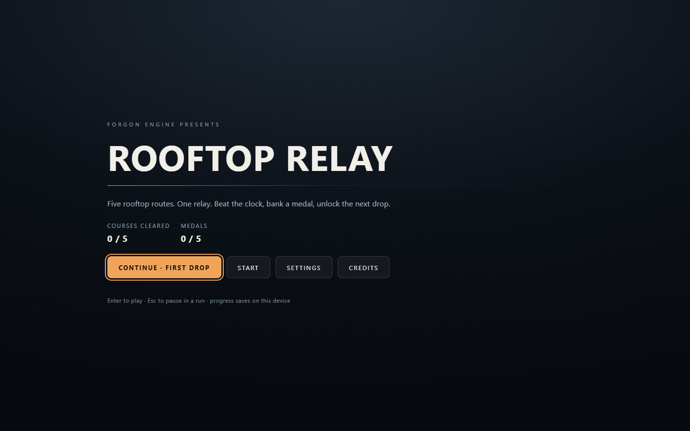
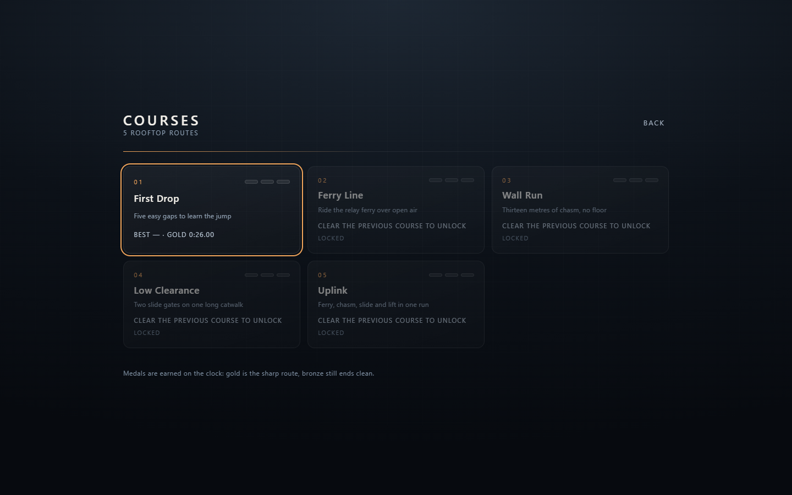
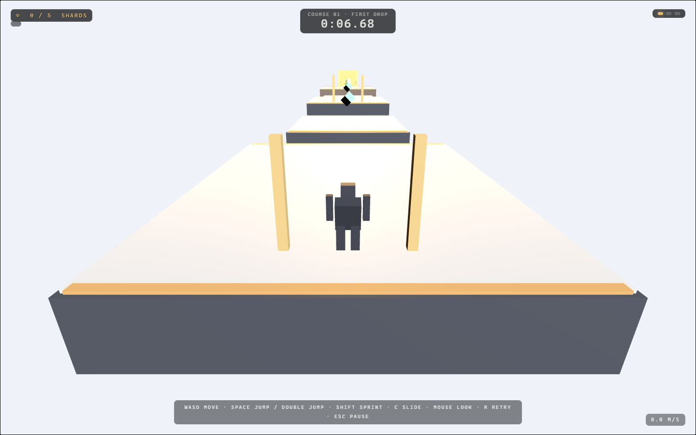

# Rooftop Relay
Author: Nitish

Original five-course parkour campaign authored file-first on the Forgon runtime: **303 entities across 5 scenes, 5 ferry/lift prefabs, 25 shards, 17 relay gates, 6 sentinels and 3 moving platforms**, plus a synthesized ambient loop and finish cue. Every course is an ordinary scene; `progression/campaign.json` sequences them, sets medal times and unlocks them in order.



The game ships with a real shell: title screen, course select with medals and best times, results, pause, settings (master volume, look sensitivity, reduced motion), sequential unlocking and a versioned local save. Progress is stored per campaign under `forgon.campaign.<campaignId>.v1` in `localStorage`; damaged or unknown saves reset safely instead of throwing.




| # | Course | Route | Gold / Silver / Bronze |
|---|---|---|---|
| 1 | First Drop | five easy gaps, 5 shards | 0:26 / 0:36 / 0:50 |
| 2 | Ferry Line | a 14 m gap crossed by the relay ferry | 0:34 / 0:46 / 1:02 |
| 3 | Wall Run | a 13 m chasm, double jump and wall-run faces | 0:38 / 0:52 / 1:10 |
| 4 | Low Clearance | a long catwalk with two slide gates | 0:36 / 0:50 / 1:08 |
| 5 | Uplink | ferry, chasm, slide gate and a rising lift | 0:54 / 1:12 / 1:35 |

## Play it

From the repository root:

```powershell
pnpm --filter @forgon/game-preview dev
```

then choose **Play Rooftop Relay**. Controls: WASD move, mouse look (pointer lock or drag), Shift sprint, Space jump / double jump, jump into a wall to wall-run and again to wall-jump, C slide, R retry, Esc pause. Touch (two-thumb joystick + look) and gamepads work too.

The standalone export is a complete game:

```powershell
pnpm --filter @forgon/cli forge build --target web ../../examples/rooftop-relay --out ../../.artifacts/rooftop-relay
```

Serve the output folder with any static server and open it; the campaign menu is the entry point.

## Project files

```text
rooftop-relay/
├── game.project.json            # startScene = course 1, campaign = progression/campaign.json
├── progression/campaign.json    # titles, medal times, sequential unlock
├── scenes/course-01..05.scene.json
├── prefabs/gen_*.prefab.json    # five relay-ferry prefabs, one palette each
├── screenshots/                 # verified menu, course select and gameplay captures
├── authoring/generated.json     # generated base (course 1) + empty override set
├── authoring/relay-ferry-0*.bindings.json
└── assets/                      # loop + chime WAV, wordmark SVG, palette, provenance
```

## Commands

```powershell
pnpm --filter @forgon/cli forge inspect ../../examples/rooftop-relay
pnpm --filter @forgon/cli forge validate ../../examples/rooftop-relay
pnpm --filter @forgon/cli forge bake ../../examples/rooftop-relay --seed night-shift
pnpm --filter @forgon/cli forge create ../my-relay --template rooftop-relay
```

Bake emits `{scene, authoring}` for the generated base (course 1) to stdout and fails on unrecorded manual edits; only `--write` persists it. The other four courses are generated scenes too, but the authoring artifact currently tracks the base scene only, so bake regeneration covers course 1 — document that limitation rather than pretend whole-campaign regeneration exists.

## Verification

`packages/game-runtime/test/campaign.test.ts` proves, headlessly and against the checked-in project:

- every adjacent deck gap clears with the shipped run/jump vocabulary;
- the 13 m chasms clear with the double jump, framed by wall-run faces;
- every ferry and lift carries a rider to the next deck;
- both slide gates stop a standing runner and pass a sliding one;
- every course starts on its spawn gate and ends at its goal;
- medals, first-clear unlocking, best times, save round-trips, migration and corrupt-save recovery.

`packages/cli/test/build-web.test.ts` builds this project and checks the shipped `game.json` carries all five scenes and the campaign document, and that the menu shell is bundled.

## Honest limits

- Geometry is authored primitives and inline colours; the runtime does not render textures or models yet.
- The campaign contains **no script components**, so `forge build --target web` accepts it — scripting is a Studio-only feature today.
- Studio Play mounts one scene at a time (the start scene), so the campaign shell currently runs in the standalone player and the exported build, not inside the editor viewport.
- Progress is device-local (`localStorage`); there is no cloud save or account.
- Audio is two synthesized cues; there is no music system or mixer.

`assets/PROVENANCE.md` documents the original CC0 placeholders. The generated files are byte-exact fixture output: `packages/test-fixtures` materializes this directory from the same seed.
